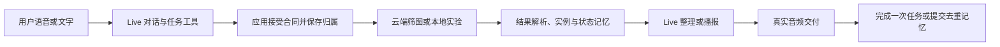

# 四种功能与模型分工

## 整体流程

普通问答不自动建立提醒。找东西和持续播报通过各自明确门径启动，与提醒独立；普通插话不能清空有效提醒。谷歌与阿里在模型分工、能力和延迟上有差异，应用生命周期的要求相同。

## 主动提醒

Live通过`set_active_reminder_contract`提交合同，应用accepted后才确认。四类为`appearance_once`、`appearance_new_instances`、`result_once`、`change_continuous`，分别对应一次出现、不同新实例、指定结果达到和无终点的连续变化。普通当前问答、投诉、模型邀请用户汇报不构成新增授权。

云端普通路线由轻量视觉模型筛图，应用解析结果，再用Live播报。判定命中不等于用户已经听到：pending delivery必须收到有效音频和回合结束，才能完成一次任务或提交实例/变化记忆。无音频、截断、打断、断线和退出必须释放待交付，不能把旧事件带回新任务。

阿里实时模型漏交工具时已有异步合同归一化补建；none不能冒充成功。原生本地入口还有合同决策轮的暂存保护，避免先说一次未受理的承诺，补建后再确认。该保护只作用阿里，不改变Google。

## 供应商与文件入口

| 路线 | 当前实现分工 | 优先阅读 |
| --- | --- | --- |
| Google | Live对话、合同、声音；Lite视觉检查；网页服务器转接、授权iOS可直连 | `providers/google/public/app.js`、`providers/google/server.js` |
| 阿里 | 实时声音和合同；视觉/普通问答/搜索分工；两个视频入口有差别 | `providers/aliyun/public/app.js`、`providers/aliyun/server.js`、`shared/aliyun-*.js` |
| 35B本地实验 | 云端合同，本地Y/N筛图，阿里结合当前图整理并播报 | `LocalScreenEngine.swift`、`LocalScreenReminderBridge.swift` |
| 1B助推实验（当前） | Google Live合同，本地1B粗筛，正触发交Google Lite完整审核，应用与原Live播报/交付 | `LocalScreenReminderBridge.swift` |
| 1B直接Live复核（历史） | 本地触发后同一Live看图决定是否说；因超时、只有转写无声音等问题停用 | `LocalScreenConditionalLive.swift`，当前不加载 |

`public/app.js`仍是较大的现有运行时。可通过函数名定位：`handleGeminiReminderAlert`、`runGeminiActiveReminderTick`、`buildGeminiLiveSystemInstruction`、`handleRealtimeServerEvent`、`buildRealtimeInstructions`、`sendGeminiLiveEvent`。服务器提供合同归一化、视觉模型适配、搜索桥和实时代理。网络搜索只返回真实摘要与链接，不把摘要当作整页或现场事实。

## 原生与无障碍

`ios-native/AccessibleVision/Services`负责相机、音频诊断、手部/深度、权限和网页桥。`ScreenShare`为独立屏幕共享运行时，源文件有清单哈希。`LocalScreening`是本地模型实验。教学专用桥已排除。

16k输入、24k输出、原播放队列及实际播放时抑制麦克风是既有协作基础。停止、切换、暂停和会话替换后，旧图片、转写、工具和音频不得复活。异步请求有归属和取消，不能用无限重试掩盖故障。

请先在现有供应商接口处做可选适配，提供准确率、首个有效声音、P50/P95、失败与恢复、调用次数和内存等证据，再讨论替换默认路径。
